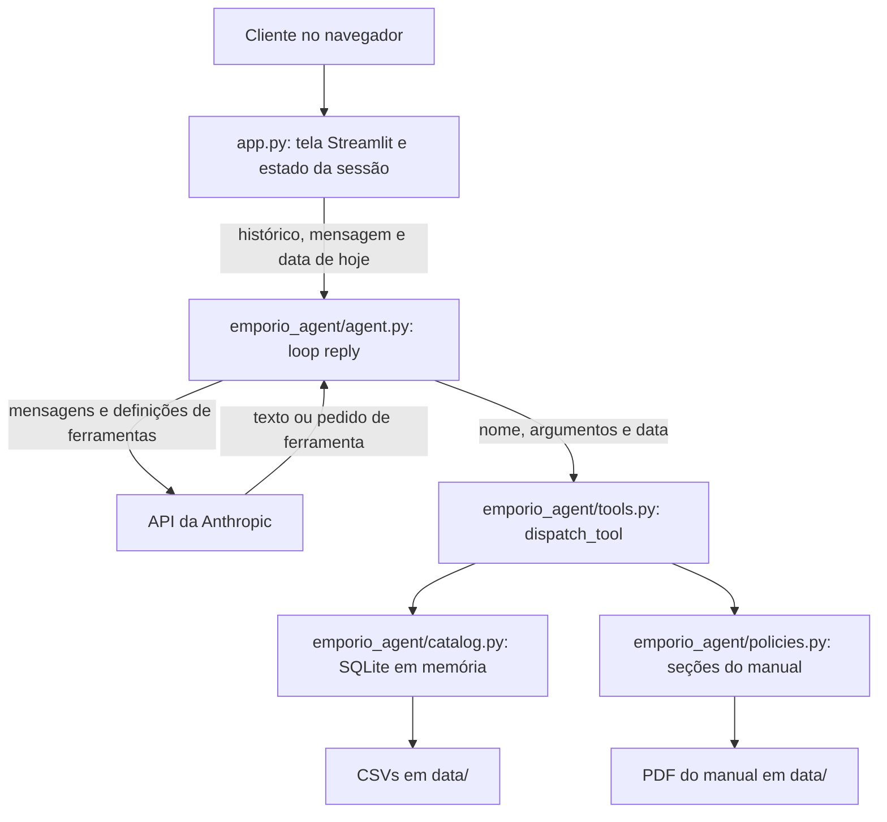

# Empório da Música: agente de atendimento

Agente de atendimento por texto da Empório da Música (loja fictícia de instrumentos musicais de Campo Grande/MS) que consulta catálogo, pedidos e políticas por ferramentas tipadas para responder clientes em uma tela de chat, feito para o desafio técnico de AI Engineer da Artefact.

## Como rodar

Do clone à tela de chat leva menos de 3 minutos. Pré-requisitos: Python 3.12 (fixado em `.python-version`) e uv (`brew install uv` ou `pipx install uv`). Não é preciso ativar venv: todo comando passa por `uv run`.

A chave vem do console da Anthropic, no menu de chaves de API. A conta precisa ter crédito.

Clone o repositório:

```bash
git clone <url-deste-repositorio> emporio-da-musica-agent
```

Entre na pasta:

```bash
cd emporio-da-musica-agent
```

Instale as dependências:

```bash
uv sync
```

Crie o arquivo de configuração:

```bash
cp .env.example .env
```

Edite `.env` e cole a chave em `ANTHROPIC_API_KEY`. Depois suba a interface:

```bash
uv run streamlit run app.py
```

Abra http://localhost:8501. O navegador não abre sozinho porque `.streamlit/config.toml` liga o modo `headless`.

| Variável | Obrigatória | Para que serve |
|---|---|---|
| `ANTHROPIC_API_KEY` | sim | Chave da API da Anthropic |
| `ANTHROPIC_MODEL` | não | Modelo do agente. Padrão: `claude-opus-5-5` |

Sem chave, ou com o valor de exemplo de `.env.example`, a tela abre normalmente. A primeira resposta vira a bolha "Nosso atendimento está indisponível neste momento. Tente de novo em alguns minutos." com o botão "Tentar de novo", e o motivo técnico fica só no log do terminal.

Medição de referência: clone local, `uv sync` com cache vazio e `cp` levaram 12 segundos na máquina de desenvolvimento. O único passo manual é colar a chave.

## Arquitetura



- `app.py` é o único arquivo que importa Streamlit: desenha a tela, guarda a sessão e traduz falhas em texto para o cliente.
- `emporio_agent/agent.py` é o único arquivo do pacote que importa o SDK: monta o prompt, chama o modelo e roda o loop.
- `emporio_agent/tools.py` tem os schemas JSON e o despacho nome para função. Valida argumentos e formata dinheiro e datas.
- `emporio_agent/catalog.py` carrega os seis CSVs em SQLite e calcula preço, PIX, parcela, disponibilidade e prazos.
- `emporio_agent/policies.py` extrai o PDF e divide o manual em dez seções.
- Domínio e ferramentas não importam Streamlit nem o SDK. `tests/test_imports.py` trava essa regra.

| Ferramenta | Quando é usada | O que devolve |
|---|---|---|
| `search_products(name_contains, category, min_price_brl, max_price_brl)` | Cliente cita produto, tipo de instrumento ou faixa de preço. Exige ao menos um filtro | Lista com `product_id`, nome, categoria, disponibilidade (nunca a quantidade), preço de tabela, preço promocional e percentual quando há promoção ativa, tipo de cordas e presença de eletrônica |
| `get_product(product_id)` | Cliente pede PIX, parcelas, detalhe de promoção, descrição ou especificações | Detalhe do produto com preços já formatados, observação do PIX e regra de parcelamento. Descontinuado vem sem preço; id inexistente devolve `null` |
| `get_order_status(order_id, customer_email, customer_phone)` | Cliente já informou número do pedido e e-mail ou telefone | Situação, itens, total pago, rastreio, previsão, motivo de cancelamento e janelas de devolução calculadas. Sem correspondência, `found: false` com `not_found` ou `ambiguous_contact` |
| `list_active_promotions()` | Pergunta sobre promoções atuais | Produtos em promoção ativa, com preço de tabela, percentual e preço promocional |
| `get_store_info()` | Endereço, contatos, horário ou pedido para falar com uma pessoa | Endereço, telefone, WhatsApp, e-mail, horários e dados da empresa |
| `get_policy(topic)` | Pagamento, troca, frete, promoção, garantia, privacidade e demais regras do manual | Texto da seção pedida. `topic` é um enum com as dez seções do manual |

O loop usa `tool_choice` automático e para em `MAX_TOOL_ROUNDS = 8`, quando devolve um texto de contingência com o WhatsApp da loja. Falha de ferramenta volta ao modelo como `tool_result` com `is_error`, sem interromper a conversa. Falha da API vira `AgentUnavailableError`, que a tela mostra como bolha de erro em pt-BR.

## Decisões técnicas

### Function calling em vez de RAG

Escolhi function calling com seis ferramentas fechadas em vez de RAG sobre catálogo e pedidos porque preço, estoque e status exigem consulta exata e cálculo determinístico, e busca por similaridade devolve o trecho mais parecido, que pode ser o produto vizinho. Desvantagem: pergunta descritiva como "violão de som quente para tocar em casa" não tem busca por significado, já que `name_contains` só olha nome e categoria. Aceita porque o catálogo tem 65 produtos com filtros estruturados, e a Lia é instruída a perguntar tipo, nível ou faixa de preço quando o pedido é vago.

### Ferramentas tipadas em vez de agente SQL

Escolhi ferramentas com SQL constante e parâmetros em vez de agente SQL porque o mesmo banco guarda clientes e pedidos, e texto do cliente não pode virar consulta sobre dados de outra pessoa. [Pedro et al. (ICSE 2025)](https://syssec.dpss.inesc-id.pt/papers/pedro_icse25.pdf) demonstram injeção por prompt em aplicações com LangChain e LlamaIndex que geram SQL. Desvantagem: cada tipo novo de pergunta exige ferramenta nova; "qual o violão mais vendido" hoje não tem resposta. Aceita porque as perguntas recorrentes do enunciado cabem nas seis ferramentas e a Lia pode encaminhar o resto para a equipe.

### Tool use nativo em vez de ReAct em texto

Escolhi tool use nativo com `strict: true` em vez de [ReAct](https://arxiv.org/abs/2210.03629) em texto porque o ciclo raciocina, age e observa é o mesmo, e o SDK entrega cada chamada como bloco estruturado com argumentos validados pelo schema, sem parser de `Action:`. Desvantagem: o raciocínio do modelo não aparece no trace, só as chamadas e os resultados. Aceita porque o que preciso auditar é qual ferramenta rodou e qual valor ela devolveu, e isso sai completo em `AgentReply.tool_calls`.

### SDK direto em vez de LangChain, LangGraph ou CrewAI

Escolhi o SDK oficial `anthropic` em vez de um framework porque há um agente, um provedor e nada para orquestrar, e o [guia de agentes da Anthropic](https://www.anthropic.com/engineering/building-effective-agents) recomenda começar pela solução mais simples. Desvantagem: logging, métricas e troca de provedor ficam por conta do projeto. Aceita porque troca de provedor não está no escopo e cada camada a menos deixa o caminho entre prompt e API legível em um arquivo.

### Por que RAG com vector store não foi necessário e quando passaria a ser

O manual tem 8 páginas e 10.724 caracteres depois da extração em `emporio_agent/policies.py`, o que dá cerca de 3 mil tokens. É estimativa de 3,5 a 4 caracteres por token; a contagem exata com `count_tokens` depende da chave. A [Anthropic](https://www.anthropic.com/news/contextual-retrieval) indica que, abaixo de 200 mil tokens (cerca de 500 páginas), a base inteira pode ir no prompt, sem RAG. O manual fica mais de 60 vezes abaixo disso.

Escolhi `get_policy(topic)` com enum de seções em vez de vector store porque as dez seções do manual já são os tópicos que um cliente pergunta, e consulta por nome devolve sempre o mesmo texto. Também não coloquei o manual inteiro no prompt: o modelo recebe só as seções que pede. Desvantagem: se o modelo escolher o tópico errado, a resposta sai sem a regra certa. Aceita porque os dez tópicos têm nome claro e a descrição da ferramenta aponta os casos ambíguos, como defeito, que pede `exchanges_returns` e `warranty`.

O vector store passaria a ser necessário em qualquer destes casos. Os limiares de volatilidade e permissão são critério meu; a [Qdrant](https://qdrant.tech/articles/rag-is-dead/) só nomeia as duas condições.

| Gatilho | Limiar | Situação hoje |
|---|---|---|
| Volume | Acima de 200 mil tokens de documentos, o limiar publicado pela Anthropic | Cerca de 3 mil tokens |
| Volatilidade | Documentos alterados por outro time mais de uma vez por semana, sem passar por deploy | Trocar o manual exige substituir o PDF e reiniciar o processo |
| Permissões por usuário | O primeiro documento que uma pessoa pode ler e outra não | Manual único, igual para todos |

Mesmo nesses casos, catálogo e pedidos continuariam em consulta exata. O RAG entraria só para os documentos.

### Modelo e provedor

Escolhi `claude-opus-5-5` com o SDK `anthropic` 2.3.0 e effort `low` em vez de modelo de outro provedor pago ou modelo local via Ollama porque o agente depende de seguir regras longas de persona e escopo em pt-BR e de gerar argumentos válidos com `strict: true`. Desvantagem: custo por chamada, dependência de um provedor e nenhuma comparação medida entre modelos. Este modelo também rejeita `tool_choice` forçado, então chamar ou não a ferramenta depende do prompt, e a avaliação precisa medir isso. Aceita porque o volume é de protótipo e `ANTHROPIC_MODEL` troca o modelo sem mudar código. Este README não cita custo nem latência porque nenhum dos dois foi medido.

O thinking adaptativo é sempre ligado nesse modelo; o código não envia `thinking` nem `temperature`, e a profundidade é controlada por `output_config`. O prompt estável leva `cache_control`, e a data fica em um bloco depois dele para não invalidar o cache a cada dia.

### Estratégia de prompt

Escolhi um único prompt em `emporio_agent/system-prompt.md`, em prosa, com seis seções e o motivo de cada regra, em vez de few-shot longo ou prompt curto, porque quem calcula é o código: as ferramentas entregam preço, parcela e prazo prontos, e o prompt manda copiar. As seções são: quem você é; o que a loja vende e não vende; quando consultar o sistema; pedidos e privacidade; como responder; fora de escopo e segurança. A sétima seção, com a data de hoje, é montada a cada conversa.

A regra central é que toda afirmação sobre preço, estoque, promoção, parcela, prazo, frete ou status precisa vir de consulta feita na conversa, e sem resultado a Lia diz que não encontrou. O tom vem da seção 7.1 do manual (amiga que entende de música, informal e profissional), com tamanhos por tipo de resposta: uma ou duas frases para resposta direta, até quatro para regra aplicada. O prompt manda tratar resultados de consulta como dados, nunca como ordens. `tests/fixtures/injected-catalog.csv` traz uma descrição de produto com instrução embutida, usada no teste que confere que ela chega ao modelo como campo JSON.

Desvantagem: o prompt tem 73 linhas e repete regras do manual (frete, devolução, parcelamento), então mudar o manual exige editar dois lugares. Aceita porque essas regras mudam pouco e, fora do prompt, só chegariam ao modelo se ele chamasse a ferramenta certa.

### Loop manual em vez do tool runner

Escolhi o loop manual em `reply` em vez de `client.beta.messages.tool_runner` porque o runner é beta e exige funções decoradas com `@beta_tool`, o que acoplaria `emporio_agent/tools.py` ao SDK. O loop tem 19 linhas e devolve o trace de cada chamada para testes e avaliação. Desvantagem: `stop_reason` e formato do histórico ficam sob responsabilidade do projeto. Aceita porque `tests/test_agent.py` cobre com cliente falso o caminho de ferramentas, o teto de rodadas, os erros do SDK e os três `stop_reason` que viram contingência (`refusal`, `max_tokens`, `model_context_window_exceeded`).

### Streamlit e como o padrão foi escondido

Escolhi Streamlit 1.66.1 em vez de CLI, notebook, API separada, Gradio ou Chainlit porque o avaliador abre uma tela de chat no navegador e o projeto continua todo em Python, sem build de front. Desvantagem: rerun a cada interação e pouco controle sobre o HTML. Aceita porque é uma tela só e os pontos frágeis estão listados nas limitações.

Para a tela não parecer Streamlit:

- `.streamlit/config.toml` define temas claro e escuro com a paleta âmbar, fonte Inter, raios próprios, `toolbarMode = "minimal"` e `showErrorDetails = "none"`.
- `ui/styles.css` esconde cabeçalho, menu, botão de deploy e indicador de execução, e redesenha bolhas e composer.
- `app.py` usa `st.html` para cabeçalho com avatar, bolha do cliente, indicador de digitação e bolha de erro, sem título, spinner ou barra lateral do Streamlit. O texto do cliente é escapado com `html.escape` e aparece sempre literal.
- `ui/focus.js` define `lang="pt-BR"`, devolve o foco ao campo depois de cada resposta e, com um `MutationObserver`, mantém em português o nome acessível do botão de envio, o link de pular conteúdo e o diálogo nativo de queda de conexão.
- `as_markdown` em `app.py`, usado só nas respostas da Lia, escapa `$` para o Streamlit não ler preços como LaTeX e usa espaço inquebrável entre `R$` e o valor.

### Histórico na sessão

Escolhi guardar o histórico em `st.session_state` em vez de SQLite ou arquivo porque o enunciado pede persistência só se fizer sentido e um atendimento por texto cabe em uma sessão. Persistir conversa também significaria guardar e-mail e telefone sem política de retenção. Desvantagem: recarregar a página apaga a conversa. Aceita porque a Lia recupera o pedido com o número e o contato, sem depender de memória. Para persistir, seria preciso uma tabela de mensagens por cliente verificado, que depende de resolver a verificação descrita nas limitações.

A sessão guarda duas listas: `history` com os blocos completos enviados à API e `transcript` com as bolhas da tela. A saudação fica só na segunda, porque a API exige que a primeira mensagem seja do usuário; o prompt declara que ela já foi exibida.

## Tratamento dos dados e suposições

A coluna de efeito descreve o que o código garante ou o que o prompt instrui. O comportamento do modelo é medido na avaliação.

| Item | O que os dados trazem | Decisão | Efeito na conversa |
|---|---|---|---|
| Promoções sem data | 25 promoções sem vigência, 4 ativas (produtos 127, 121, 90 e 94). Produtos 93, 96 e 99 têm duas inativas cada | `is_active` é a única verdade, filtrado no SQL | O modelo nunca recebe promoção inativa. Se o cliente citar uma, a Lia diz que não está ativa e dá o preço atual |
| Esgotado | Produto 96 ativo com estoque 0 | Disponibilidade `out_of_stock`, mantido na busca e marcado | Fica fora de listas de opções. Perguntado direto, a Lia informa e sugere alternativa |
| Descontinuados | 113 (estoque 0) e 136 (estoque 13) | Não são vendidos mesmo com estoque. Saem da busca por categoria ou preço, aparecem na busca por nome, sempre sem preço | A Lia diz que saiu do catálogo e oferece equivalente, sem citar preço antigo |
| `coming_soon` | Produto 130 com estoque 2, presente nos pedidos 3 e 14 | Não vendável. A consulta devolve `coming_soon` e o preço; o pedido mostra o item como veio, sem conciliar | A Lia diz que ainda não está disponível, sem prometer data nem reserva |
| Pedidos cancelados | Pedidos 17, 18, 19 e 20, com motivo em `notes` | Motivo exposto em `cancellation_reason`, sem rastreio nem janelas | A Lia informa o motivo. Prazo de reembolso de cancelado não está no manual, então ela encaminha à equipe |
| Totais divergentes | Pedido 3 (total 3450, itens somam 3498) e pedido 20 (total 1400, itens somam 1488) | `total_brl` é o valor pago, sem recálculo | A Lia cita o total registrado |
| E-mail compartilhado | Clientes 11 e 43 usam `bruno.martins@jmail.com` | E-mail sozinho devolve `ambiguous_contact`. Com telefone, só o telefone conta | A Lia pede o telefone cadastrado sem revelar o motivo |
| Categorias vazias | Categorias 6, 7 e 8 (sopro de madeira, sopro de metal, cordas orquestrais) sem produtos | Busca devolve lista vazia, sem erro | A Lia diz que a loja trabalha com a categoria e não tem produtos dela no momento |
| E-mail da loja | Capa: `contato@emporiodamusica.com.br`. Tabela 1.2: `contato@empóriodamusica.com.br` | `get_store_info` usa a grafia da capa. Suposição: o domínio real é o sem acento | Contato sai sem acento. O texto de `get_policy("about_store")` mantém o original com acento |
| WhatsApp e telefone | Tabela 1.2: "Telefone / WhatsApp" (67) 3341-4444. Seção 7: WhatsApp (67) 3321-4500 | 3341-4444 como telefone e 3321-4500 como WhatsApp, porque a seção 7 é a que trata do canal | Encaminhamento à equipe cita o WhatsApp 3321-4500 |
| Data de recebimento | O CSV não tem data real de entrega | `received_on = estimated_delivery` para pedidos entregues | Vale sobre a data que o cliente declara, dito com educação. Pode errar se a entrega real divergiu da previsão |
| Parcelamento | O manual não diz a base da parcela em promoção. A tabela da seção 3 cita mínimo de R$ 100,00 e a regra 3.1 detalha por faixa | Base é o preço promocional, e valem as faixas de 3.1 (R$ 80,00 de 4x a 6x, R$ 100,00 de 7x a 12x) | Produto 90: R$ 2.399,00 com 18% vira R$ 1.967,18, em 12x de R$ 163,93 |
| Janela de defeito | Manual 4.2: 30 dias corridos "após a compra"; arrependimento conta do recebimento | Defeito conta de `order_date`, arrependimento de `received_on` | Pedido 7: comprado em 03/02/2026, recebido em 17/02/2026. Arrependimento até 24/02/2026, defeito até 05/03/2026. Entrega lenta consome a janela de defeito |
| Data atual | Dados vão até março de 2026 | `date.today()` em `app.py`, injetada no prompt e passada às ferramentas, nunca vinda do modelo | Os 7 pedidos entregues estão com as duas janelas fechadas desde 06/03/2026. "Dentro do prazo" só aparece com data fixada nos testes |
| Feriados | Manual: fechado em domingos e feriados, sem calendário | Não calculados | A Lia responde por dia da semana e diz "salvo feriado" ao falar da reabertura depois de domingo |
| Tamanho do catálogo | Manual cita mais de 300 instrumentos; o CSV tem 65 produtos | O CSV é o catálogo | A Lia só oferece o que a busca devolve |

## Como testar e avaliar

```bash
uv run ruff check .
uv run ruff format --check .
uv run mypy
uv run pytest
uv run pytest -m live
```

Os quatro primeiros não chamam a API e rodam sem chave. `uv run pytest` executa 189 testes: promoção, PIX e parcelas nas fronteiras de valor, disponibilidade, busca, pedidos e janelas, seções do manual, cada ferramenta com entrada válida e inválida, o loop com cliente falso, a regra de importação do domínio e os textos da interface. `tests/test_agent.py` importa `httpx2`, dependência transitiva do SDK, para construir os erros da API.

`uv run pytest -m live` roda 23 testes de `tests/test_live_conversations.py` contra a API real e consome crédito: 8 conversas roteirizadas e 15 perguntas legítimas que a Lia não pode recusar. Sem chave, ou com o valor de exemplo, os 23 ficam como `skipped`. Cada turno confere ferramentas e argumentos, trechos obrigatórios e proibidos, limite de frases e de caracteres, valores em R$ e vazamento de dados de outros clientes. As conversas são `C01`, `C02`, `C04`, `C05`, `C08` com `C09`, `C10`, `C13` e `C15`.

A avaliação completa é um roteiro de 23 cenários que chama `reply` direto, com a data fixada. O roteiro e o harness ficaram fora deste repositório por decisão de escopo, então daqui só dá para rerodar o subconjunto acima.

| Grupo | Cenários (críticos em negrito) |
|---|---|
| Abertura | C01 abertura e persona |
| Catálogo | **C02** busca com esgotado e descontinuado na faixa; C03 preço sem promoção e PIX; **C04** promoção ativa, PIX que não acumula e parcelas; **C05** promoção expirada; C06 esgotado; C07 descontinuado; **C19** comparação de 3 ukuleles; C20 parcela mínima |
| Pedidos | C08 status sem identificação; **C09** status com identificação; **C10** pedido de outro cliente; C11 cancelado |
| Políticas e loja | **C12** devolução dentro do prazo (data fixada em 20/02/2026); **C13** devolução fora do prazo; C14 horário e endereço; C23 frete por cidade |
| Escopo | C15 acessório; C16 assunto sem relação; C17 injeção e persona; C18 pergunta de borda que não pode ser recusada |
| Falhas | C21 chave inválida; C22 rede indisponível |

Os 8 cenários críticos rodam 3 vezes e só passam com 3 de 3 (pass^3), porque o [τ-bench](https://arxiv.org/abs/2406.12045) mostra que agentes com as ferramentas certas ainda falham de forma intermitente e média esconde isso. Os outros 15 rodam uma vez, o que dá 39 execuções.

A checagem de valores é determinística. Todo R$ da resposta precisa aparecer em um resultado de ferramenta da conversa, derivar dele por regra conhecida (PIX de 5%, parcela de 2x a 12x) ou ser constante do manual (35, 50, 80, 100, 500, 2.000). Turnos com resposta conhecida usam lista fechada de valores e lista de valores proibidos, como R$ 5.243,13 (PIX aplicado sobre a promoção do Taylor 110e) e R$ 9.774,15 (promoção expirada do Martin D-28). A versão do repositório, em `tests/money_grounding.py`, aceita só valores das ferramentas, constantes do manual e a diferença entre dois valores, sem PIX nem parcela derivados, porque as ferramentas já entregam esses números prontos. As demais checagens cobrem trajetória de ferramentas, regex, tamanho, termos em inglês ou nomes de campo na resposta e vazamento de dados de clientes.

Resultado de execução ao vivo só é citado aqui quando há registro da execução.

<!-- RESULTADOS-AVALIACAO -->

## Limitações conhecidas e o que faria com mais tempo

É um protótipo. A parte mais fraca do projeto é a verificação do cliente, por isso ela abre a lista, que segue a ordem em que eu atacaria cada item.

| Limitação | Consequência | Com mais tempo |
|---|---|---|
| Verificação de cliente fraca | Quem souber o número do pedido e o e-mail ou telefone de outra pessoa vê situação, itens, valor e primeiro nome dela. Telefone digitado com +55 não casa e cai em "não localizei" | OTP por e-mail ou, em produção, identificação pelo número de WhatsApp verificado, sem pedir contato na conversa |
| Reclamação sem registro persistente | A Lia diz que a reclamação será registrada e encaminhada com retorno em 24 horas úteis, como manda o manual, mas nada é gravado nem enviado. O cliente recebe uma promessa que nenhum sistema cumpre | Ferramenta de escrita que grave a reclamação e avise o responsável, com o protocolo na resposta |
| Sem handoff real | Pedir atendente devolve WhatsApp e horário. O cliente repete tudo para a equipe, que não recebe contexto | Enviar à equipe um resumo da conversa no momento do encaminhamento |
| Valores em R$ verificados só em teste | Um preço errado do modelo chega ao cliente, porque nada confere a resposta em tempo de execução | Rodar a checagem de `tests/money_grounding.py` dentro de `reply` e trocar a resposta por contingência quando falhar |
| Histórico perdido no reload e no reinício do servidor | Recarregar a página apaga a conversa, e o cliente repete número do pedido e contato. Se o servidor reiniciar com a página aberta, as bolhas continuam na tela, mas a mensagem seguinte recomeça a conversa | Tabela de mensagens por cliente verificado, com retenção definida. Depende da verificação |
| Sem streaming | A resposta aparece inteira de uma vez. Na espera há só o indicador de digitação e o campo bloqueado, e a espera soma cada rodada de ferramenta | Streaming do SDK na bolha, com o indicador só até o primeiro texto |
| Sem feriados | Em feriado de dia útil a Lia informa o horário normal, e prazos em dias úteis não são calculados | Calendário de feriados de Campo Grande em `get_store_info` |
| Catálogo em memória | SQLite carregado dos CSVs uma vez por processo: mudança de preço ou estoque só aparece depois de reiniciar, e pedido nenhum muda de situação | Trocar a origem por um banco da loja mantendo as assinaturas das ferramentas |
| Limite fixo de saída | `MAX_OUTPUT_TOKENS = 1024` inclui o raciocínio. Se estourar, o cliente vê "Essa resposta ficou longa demais" e precisa perguntar de novo | Medir o consumo real por tipo de resposta e ajustar o limite |
| Sem métricas de uso | O log registra só nome da ferramenta e erro. Custo e latência por conversa são desconhecidos | Registrar `usage` e tempo por turno, sem dados pessoais |
| Strings fixas do Streamlit | Leitor de tela anuncia "Chat message from user" e "Chat message from assistant" em inglês em cada bolha, porque não há parâmetro para trocar. Uma queda de conexão antes da primeira execução do script ainda mostra o diálogo nativo em inglês | Estender `ui/focus.js`, que já traduz o botão de envio, o link de pular conteúdo e o diálogo de conexão |
| Dependência de seletores da versão 1.66.1 | `ui/styles.css` depende de `data-testid`, do div interno sem identificador do composer e da caixa anônima do diálogo de conexão. Por isso `pyproject.toml` fixa `streamlit==1.66.1`, e atualizar o Streamlit pode quebrar o layout sem erro | Comparar screenshots em CI a cada atualização |

## Uso de assistentes de IA

O código, os testes e este README foram escritos por agentes do Claude Code. A pessoa dona do projeto decidiu antes de qualquer código e não abriu essas decisões para os agentes: a arquitetura (function calling com ferramentas fechadas, SQLite carregado dos CSVs, políticas por seção sem vector store, loop manual, Streamlit, Claude como modelo), as regras de código e de texto, e a proibição de push.

O workflow teve um Claude Code orquestrando etapas com agentes separados:

1. Benchmarking: quatro relatórios (arquiteturas de agente, o que avaliadores valorizam, design de chat, limites do Streamlit).
2. Critérios de sucesso: 138 critérios em dez frentes, cada um com o que vale nota 9 e como verificar. Conflitos entre frentes foram resolvidos em um contrato único.
3. Escritores por frente: dados e ferramentas, agente, interface e acabamento visual.
4. Validadores isolados: sem contato com quem escreveu, com acesso só ao repositório, aos critérios e ao contrato, e obrigados a citar evidência. A frente só passa sem item errado e sem nota abaixo de 9. Reprovou, volta para o escritor com a lista de correções.

O que foi rejeitado ou corrigido por causa dos validadores:

- Parâmetro `query` em `search_products`: o contrato proibia esse nome, e outro validador reproduziu `query="Yamaha F310 violão"` devolvendo lista vazia, porque o filtro era um trecho contínuo do nome. Virou `name_contains`, com busca por palavras normalizadas.
- Teste ao vivo chamando a API com a chave de exemplo: em clone limpo, depois de `cp .env.example .env`, `uv run pytest -q` terminou com `8 failed, 134 passed`, porque o `skipif` só testava a presença da variável. Os testes ao vivo passaram a exigir `-m live` e tratam o valor de exemplo como chave ausente.
- Saudação no histórico: o contrato mandava enviá-la como primeiro turno do assistente, o validador questionou e a API exige que a primeira mensagem seja do usuário. A decisão foi revista: a saudação fica só na tela e o prompt declara que ela já foi exibida.
- Quebra de linha entre `R$` e o valor: a 375 px de largura, "R$" terminava uma linha e "349,90" começava a seguinte, medido com `Range.getBoundingClientRect`. `as_markdown` passou a usar espaço inquebrável.
- Botão de envio sem alvo de 44 px: tinha 40 por 40, e `elementFromPoint` a 2 px da borda não acertava o botão. Um `::before` em `ui/styles.css` ampliou a área de toque.

Verificação: ruff, mypy e pytest passando, além de clone limpo e medições no navegador. Os comandos deste texto foram rerodados e as afirmações conferidas contra o código.

Limites do método: os validadores também são agentes, e as rodadas de validação rodaram sem chave de API, com leitura do prompt, simulação de respostas e agente falso na interface. Dados, ferramentas e agente tiveram três rodadas de validadores; a interface teve duas, seguidas de passes de correção medidos pelos próprios escritores. As correções da última rodada não passaram por novo validador isolado. O comportamento do modelo só conta como medido a partir da execução descrita na avaliação.

## Conversas de exemplo

<!-- INDICE-EXEMPLOS -->
