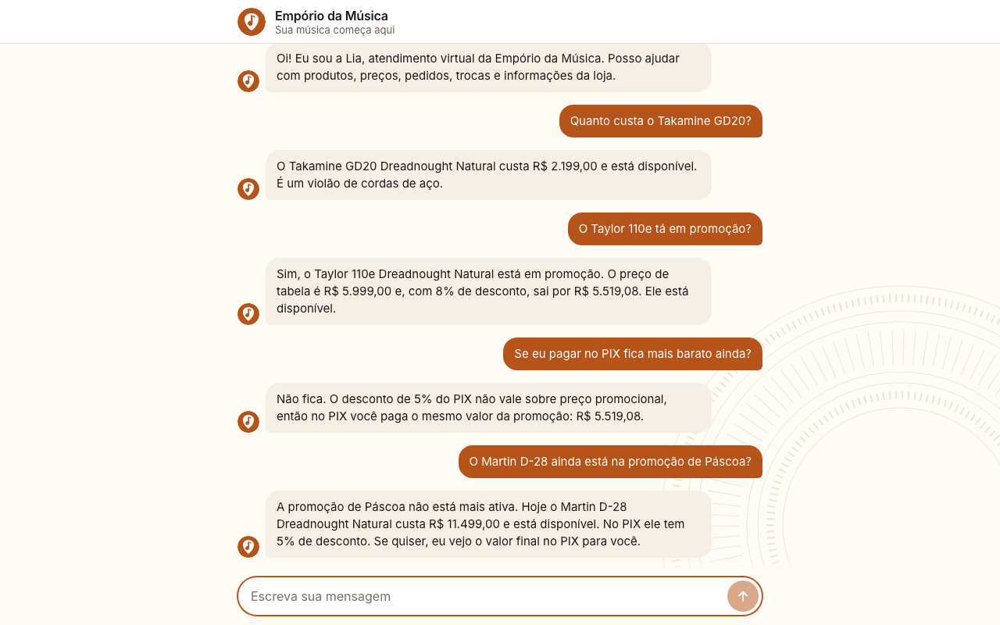
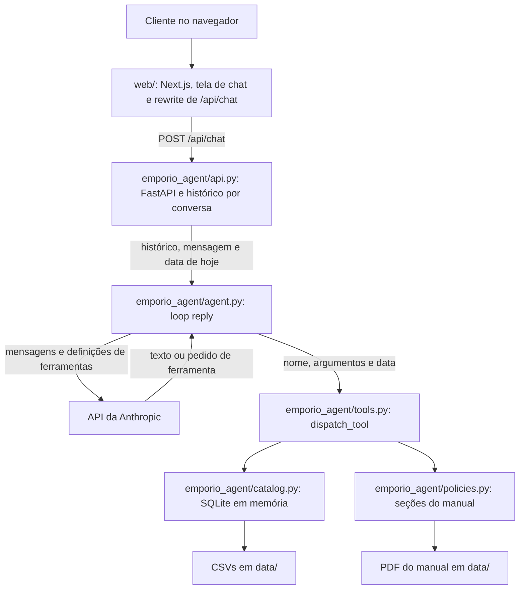

# Empório da Música: agente de atendimento

Agente de atendimento por texto da Empório da Música (loja fictícia de instrumentos musicais de Campo Grande/MS) que consulta catálogo, pedidos e políticas por ferramentas tipadas para responder clientes em uma tela de chat, feito para o desafio técnico de AI Engineer da Artefact.

Python é a linguagem principal, como exige a única restrição técnica do enunciado: o agente, as ferramentas e toda a regra de negócio ficam em `emporio_agent/`. O TypeScript fica só na interface, em `web/`, que desenha a tela e envia as mensagens por HTTP a uma API FastAPI de uma rota, por isso são dois processos para subir.

 

## Como rodar

Do clone à tela de chat leva menos de 3 minutos. Medição de referência, na máquina de desenvolvimento e com os caches do uv e do pnpm vazios: 34 segundos do início do clone local à tela responder 200 (22 de clone, `uv sync`, `pnpm install` e `cp`, e 11 até o 200). O único passo manual é colar a chave.

Pré-requisitos:

- Python 3.12 (fixado em `.python-version`) e uv (`brew install uv` ou `pipx install uv`). Não é preciso ativar venv: todo comando Python passa por `uv run`.
- Node.js 20.9 ou superior, o mínimo do Next.js 16 (testado com 24.20), e pnpm 9 (`npm install -g pnpm@9.0.0`; a versão está fixada em `web/package.json`).
- Chave da Anthropic, criada no console (console.anthropic.com), no menu de chaves de API. A conta precisa ter crédito.

Instale e configure:

```bash
git clone https://github.com/dudunog/emporio-da-musica.git
cd emporio-da-musica
uv sync
pnpm --dir web install --frozen-lockfile
cp .env.example .env
```

Edite `.env` e cole a chave em `ANTHROPIC_API_KEY`. A aplicação são dois processos, então abra dois terminais na pasta do projeto.

- Terminal 1, a API com o agente: `uv run uvicorn emporio_agent.api:app --port 8000`
- Terminal 2, a interface: `pnpm --dir web dev`

Abra http://localhost:3000.

O agente responde sem o Next.js. Com o Terminal 1 no ar: `curl -s -X POST http://127.0.0.1:8000/api/chat -H 'content-type: application/json' -d '{"conversation_id":null,"message_id":"1","message":"Qual o endereço da loja?"}'`. Use um `message_id` novo a cada pergunta: repetir o mesmo devolve a resposta guardada.

Se outro app já escuta em `127.0.0.1:3000`, o Next.js sobe na porta seguinte livre. Se ele escuta em todas as interfaces (`*:3000`, o padrão do Node), o Next.js sobe em `127.0.0.1:3000` sem aviso e `localhost:3000` abre o outro app. Nos dois casos, abra a URL impressa no terminal. Para escolher a porta, rode `pnpm --dir web dev --port 3100` e abra http://localhost:3100; com `127.0.0.1:3100` ocupado, o comando termina com `EADDRINUSE`.

| Variável | Obrigatória | Para que serve |
|---|---|---|
| `ANTHROPIC_API_KEY` | sim | Chave da API da Anthropic, lida do `.env` |
| `ANTHROPIC_MODEL` | não | Modelo do agente, lido do `.env`. Padrão: `claude-opus-5-5` |
| `API_ORIGIN` | não | Destino do rewrite do Next.js. Padrão: `http://127.0.0.1:8000`. Vem do ambiente de `pnpm --dir web dev`, não do `.env`, e em `pnpm --dir web build` fica gravada no build |

Sem chave, ou com o valor de exemplo de `.env.example`, a tela abre normalmente. A primeira resposta vira a bolha "Nosso atendimento está indisponível neste momento. Tente de novo em alguns minutos." com o botão "Tentar de novo", e o motivo técnico fica só no log do terminal da API. A API lê a chave uma vez: depois de trocá-la em `.env`, reinicie o Terminal 1. Variável já definida no shell vale mais que o `.env`, e o SDK também lê `ANTHROPIC_BASE_URL` do shell.

## Arquitetura



- `web/` é a única parte em TypeScript: desenha a tela, guarda as bolhas em estado React e traduz falhas em texto para o cliente. Preço, estoque, pedido e política não passam por lá como regra, só como texto da resposta.
- `emporio_agent/api.py` é o único arquivo que importa FastAPI: recebe a mensagem, guarda o histórico por conversa e transforma falha do agente em 503 com `reason`.
- `emporio_agent/agent.py` é o único arquivo do pacote que chama o SDK: monta o prompt, chama o modelo e roda o loop. `emporio_agent/api.py` importa dele só o tipo `MessageParam`.
- `emporio_agent/tools.py` tem os schemas JSON e o despacho nome para função. Valida argumentos e formata dinheiro e datas.
- `emporio_agent/catalog.py` carrega os seis CSVs em SQLite e calcula preço, PIX, parcela, disponibilidade e prazos.
- `emporio_agent/policies.py` extrai o PDF e divide o manual em dez seções.
- Domínio e ferramentas não importam FastAPI nem o SDK. `tests/test_imports.py` trava essa regra.

`POST /api/chat` recebe `conversation_id`, `message_id` e `message`, e devolve 200 com `conversation_id` e `reply`, 422 para mensagem em branco ou acima de 4.000 caracteres, ou 503 com `reason` (`authentication`, `connection`, `rate_limit` ou `server`), sem nada técnico no corpo. O log tem uma linha por mensagem, com o id da conversa, os nomes das ferramentas e se houve erro, nunca argumentos nem texto do cliente. `/docs`, `/redoc` e `/openapi.json` ficam desligados.

| Ferramenta | Quando é usada | O que devolve |
|---|---|---|
| `search_products(name_contains: string?, category: enum?, min_price_brl: number?, max_price_brl: number?)` | Cliente cita produto, tipo de instrumento ou faixa de preço. Exige ao menos um filtro | Lista com `product_id`, nome, categoria, disponibilidade (nunca a quantidade), preço de tabela, preço promocional e percentual quando há promoção ativa, tipo de cordas e presença de eletrônica |
| `get_product(product_id: integer)` | Cliente pede PIX, parcelas, detalhe de promoção, descrição ou especificações | Detalhe do produto com preços já formatados, observação do PIX e regra de parcelamento. Descontinuado vem sem preço; id inexistente devolve `null` |
| `get_order_status(order_id: integer, customer_email: string?, customer_phone: string?)` | Cliente já informou número do pedido e e-mail ou telefone | Situação, itens, total pago, rastreio, previsão, motivo de cancelamento e janelas de devolução calculadas. Sem correspondência, `found: false` com `not_found` ou `ambiguous_contact` |
| `list_active_promotions()` | Pergunta sobre promoções atuais | Produtos em promoção ativa, com preço de tabela, percentual e preço promocional |
| `get_store_info()` | Endereço, contatos, horário ou pedido para falar com uma pessoa | Endereço, telefone, WhatsApp, e-mail, horários e dados da empresa |
| `get_policy(topic: enum)` | Pagamento, troca, frete, promoção, garantia, privacidade e demais regras do manual | Texto da seção pedida. `topic` é um enum com as dez seções do manual |

O loop usa `tool_choice` automático e para em `MAX_TOOL_ROUNDS = 8`, quando devolve um texto de contingência com o WhatsApp da loja. `?` marca argumento que aceita `null`. Falha de ferramenta volta ao modelo como `tool_result` com `is_error`, sem interromper a conversa, e o prompt manda dizer ao cliente que não conseguiu consultar e oferecer o contato da equipe. Falha da API vira `AgentUnavailableError`, que a API devolve como 503 e a tela mostra como bolha de erro em pt-BR. Não há streaming porque as respostas são curtas (o prompt limita a nove linhas); o custo disso está nas limitações.

## Decisões técnicas

### Function calling em vez de RAG

Escolhi function calling com seis ferramentas fechadas em vez de RAG sobre catálogo e pedidos porque preço, estoque e status exigem consulta exata e cálculo determinístico, e busca por similaridade devolve o trecho mais parecido, que pode ser o produto vizinho. Desvantagem: pergunta descritiva como "violão de som quente para tocar em casa" não tem busca por significado, já que `name_contains` só olha nome e categoria. Aceita porque o catálogo tem 65 produtos com filtros estruturados, e a Lia é instruída a perguntar tipo, nível ou faixa de preço quando o pedido é vago.

### Ferramentas tipadas em vez de agente SQL

Escolhi ferramentas com SQL constante e parâmetros em vez de agente SQL porque o mesmo banco guarda clientes e pedidos, e texto do cliente não pode virar consulta sobre dados de outra pessoa. [Pedro et al. (ICSE 2025)](https://syssec.dpss.inesc-id.pt/papers/pedro_icse25.pdf) demonstram injeção por prompt em aplicações com LangChain e LlamaIndex que geram SQL. Desvantagem: cada tipo novo de pergunta exige ferramenta nova; "qual o violão mais vendido" hoje não tem resposta. Aceita porque as perguntas recorrentes do enunciado cabem nas seis ferramentas e a Lia pode encaminhar o resto para a equipe.

### Tool use nativo em vez de ReAct em texto

Escolhi tool use nativo com `strict: true` em vez de [ReAct](https://arxiv.org/abs/2210.03629) em texto porque o ciclo raciocina, age e observa é o mesmo, e o SDK entrega cada chamada como bloco estruturado com argumentos validados pelo schema, sem parser de `Action:`. Desvantagem: o raciocínio do modelo não aparece no trace, só as chamadas e os resultados. Aceita porque o que preciso auditar é qual ferramenta rodou e qual valor ela devolveu, e isso sai completo em `AgentReply.tool_calls`.

### SDK direto em vez de LangChain, LangGraph ou CrewAI

Escolhi o SDK oficial `anthropic` em vez de um framework porque há um agente, um provedor e nada para orquestrar, e o [guia de agentes da Anthropic](https://www.anthropic.com/engineering/building-effective-agents) recomenda começar pela solução mais simples. Desvantagem: logging, métricas e troca de provedor ficam por conta do projeto. Aceita porque troca de provedor não está no escopo e cada camada a menos deixa o caminho entre prompt e API legível em um arquivo.

### Por que RAG com vector store não foi necessário e quando passaria a ser

O manual tem 8 páginas e 10.715 caracteres nas dez seções extraídas por `emporio_agent/policies.py`, o que dá cerca de 3 mil tokens. É estimativa de 3,5 a 4 caracteres por token; a contagem exata com `count_tokens` depende da chave. A [Anthropic](https://www.anthropic.com/news/contextual-retrieval) indica que, abaixo de 200 mil tokens (cerca de 500 páginas), a base inteira pode ir no prompt, sem RAG. O manual fica mais de 60 vezes abaixo disso.

Escolhi `get_policy(topic)` com enum de seções em vez de vector store porque as dez seções do manual já são os tópicos que um cliente pergunta, e consulta por nome devolve sempre o mesmo texto. Também não coloquei o manual inteiro no prompt: o modelo recebe só as seções que pede. Desvantagem: se o modelo escolher o tópico errado, a resposta sai sem a regra certa. Aceita porque os dez tópicos têm nome claro e a descrição da ferramenta aponta os casos ambíguos, como defeito, que pede `exchanges_returns` e `warranty`.

O vector store passaria a ser necessário em qualquer destes casos. Os limiares de volatilidade e permissão são critério meu; a [Qdrant](https://qdrant.tech/articles/rag-is-dead/) só nomeia as duas condições.

| Gatilho | Limiar | Situação hoje |
|---|---|---|
| Volume | Acima de 200 mil tokens de documentos, o limiar publicado pela Anthropic | Cerca de 3 mil tokens |
| Volatilidade | Documentos alterados por outro time mais de uma vez por semana, sem passar por deploy | Trocar o manual exige substituir o PDF e reiniciar o processo |
| Permissões por usuário | O primeiro documento que uma pessoa pode ler e outra não | Manual único, igual para todos |

Mesmo nesses casos, catálogo e pedidos continuariam em consulta exata. O RAG entraria só para os documentos.

### Modelo e provedor

Escolhi `claude-opus-5-5` com o SDK `anthropic` 2.3.0 e effort `low` em vez de modelo de outro provedor pago ou modelo local via Ollama porque o agente depende de seguir regras longas de persona e escopo em pt-BR e de gerar argumentos válidos com `strict: true`. Desvantagem: custo por chamada, dependência de um provedor e nenhuma comparação medida entre modelos. Este modelo também rejeita `tool_choice` forçado, então chamar ou não a ferramenta depende do prompt, e a avaliação precisa medir isso. Aceita porque o volume é de protótipo e `ANTHROPIC_MODEL` troca o modelo sem mudar código. Este README não cita custo nem latência porque nenhum dos dois foi medido. O thinking adaptativo é sempre ligado nesse modelo; o código não envia `thinking` nem `temperature`, e a profundidade é controlada por `output_config`. O prompt estável leva `cache_control`, e a data fica em um bloco depois dele para não invalidar o cache a cada dia.

### Estratégia de prompt

Escolhi um único prompt em `emporio_agent/system-prompt.md`, em prosa, com seis seções e o motivo de cada regra, em vez de few-shot longo ou prompt curto, porque quem calcula é o código: as ferramentas entregam preço, parcela e prazo prontos, e o prompt manda copiar. As seções são: quem você é; o que a loja vende e não vende; quando consultar o sistema; pedidos e privacidade; como responder; fora de escopo e segurança. A sétima seção, com a data de hoje, é montada a cada mensagem.

A regra central é que toda afirmação sobre preço, estoque, promoção, parcela, prazo, frete ou status precisa vir de consulta feita na conversa, e sem resultado a Lia diz que não encontrou. O tom vem da seção 7.1 do manual (amiga que entende de música, informal e profissional), com tamanhos por tipo de resposta: uma ou duas frases para resposta direta, até quatro para regra aplicada. O prompt manda tratar resultados de consulta como dados, nunca como ordens. `tests/fixtures/injected-catalog.csv` traz uma descrição de produto com instrução embutida, usada no teste que confere que ela chega ao modelo como campo JSON. Desvantagem: o prompt tem 73 linhas e repete regras do manual (frete, devolução, parcelamento), então mudar o manual exige editar dois lugares. Aceita porque essas regras mudam pouco e, fora do prompt, só chegariam ao modelo se ele chamasse a ferramenta certa.

### Loop manual em vez do tool runner

Escolhi o loop manual em `reply` em vez de `client.beta.messages.tool_runner` porque o runner é beta e exige funções decoradas com `@beta_tool`, o que acoplaria `emporio_agent/tools.py` ao SDK. O loop tem 19 linhas e devolve o trace de cada chamada para testes e avaliação. Desvantagem: `stop_reason` e formato do histórico ficam sob responsabilidade do projeto. Aceita porque `tests/test_agent.py` cobre com cliente falso o caminho de ferramentas, o teto de rodadas, os erros do SDK e os três `stop_reason` que viram contingência (`refusal`, `max_tokens`, `model_context_window_exceeded`).

### Next.js em vez de Streamlit

O projeto começou em Streamlit, a pessoa dona decidiu migrar a interface para Next.js, o domínio foi reaproveitado e a validação foi refeita.

A troca por Next.js 16 com React 19, em vez de manter o Streamlit, foi decisão da pessoa dona. Os validadores tinham registrado três problemas abertos na tela anterior, todos por falta de controle do HTML: rótulo fixo em inglês para leitor de tela em cada bolha, CSS preso a seletores internos de uma versão fixada e flash branco na carga do tema escuro. Com React, os três saem. Desvantagem: segunda linguagem, segundo gerenciador de pacotes e dois processos para subir. Aceita porque o TypeScript fica só na interface, e o agente e toda a regra de negócio continuam em Python, a linguagem principal que o enunciado exige. A saudação e o limite de 4.000 caracteres existem nos dois lados, e `tests/test_api.py` confere que a saudação é idêntica.

### API separada mínima com FastAPI

Escolhi uma API de uma rota com FastAPI em vez de reescrever o agente em TypeScript nas rotas do Next.js, o que quebraria a restrição do enunciado, ou de usar o servidor HTTP da biblioteca padrão, porque o Next.js só alcança o agente por HTTP e o FastAPI resolve o contrato com pouco código: a anotação do corpo gera o 422, `def` síncrono roda em thread pool sem reescrever o agente e o `TestClient` testa tudo sem abrir porta. Desvantagem: duas dependências a mais (`fastapi` e `uvicorn`) e um processo a mais. Aceita porque `emporio_agent/api.py` tem cerca de 160 linhas e o domínio não importa nada dela.

### Histórico no servidor em vez de no navegador

Escolhi guardar o histórico da API em um dicionário em memória por `conversation_id` em vez de receber o histórico do navegador porque ele contém resultados de ferramentas: preços, promoções e dados de pedido. Vindo do navegador, o cliente poderia forjar um preço ou um pedido, e o modelo trataria aquilo como resultado de consulta. Um campo `history` no corpo é ignorado, e há teste para isso. Desvantagem: exige um único worker do uvicorn, reiniciar a API apaga tudo e recarregar a página (F5) reinicia a conversa, porque as bolhas ficam em estado React. Aceita porque o enunciado pede persistência só se fizer sentido, um atendimento por texto cabe em uma sessão e a Lia recupera o pedido com o número e o contato. Persistir significaria guardar e-mail e telefone sem política de retenção. Para isso, seria preciso uma tabela de mensagens por cliente verificado, que depende de resolver a verificação descrita nas limitações.

O servidor nunca adota um id escolhido pelo cliente: id nulo ou desconhecido começa conversa nova, com uuid4 próprio. Falha do agente não altera o histórico, e um Lock por conversa serializa mensagens simultâneas. A saudação fica só na tela, porque a API do modelo exige que a primeira mensagem seja do usuário; o prompt declara que ela já foi exibida.

### Idempotência por `message_id`

Escolhi um `message_id` gerado no navegador por mensagem, igual no reenvio, em vez de confiar que reenviar é seguro, porque "Tentar de novo" depois de tempo excedido chegava com o turno já gravado: com um modelo simulado travado por 200 s, o histórico ficou com a mesma mensagem duas vezes. O reenvio do mesmo id devolve a resposta guardada sem chamar o modelo e, se a primeira chamada ainda estiver em curso, espera o Lock e devolve o resultado. Na primeira mensagem, quando o navegador ainda não tem `conversation_id`, o próprio `message_id` localiza a conversa. Desvantagem: a API só guarda o último id e a última resposta de cada conversa, então um id mais antigo seria tratado como mensagem nova. Dois clientes que enviem o mesmo `message_id` com conversa nula dividem a conversa, e o segundo recebe a resposta do primeiro. Aceita porque a interface só oferece reenvio na última bolha de erro e gera 16 bytes aleatórios por mensagem, então a colisão só acontece com cliente que repete ids de propósito.

### Um único rewrite em vez de CORS

Escolhi um rewrite só de `/api/chat` no Next.js, com destino em `API_ORIGIN`, em vez de o navegador chamar a porta da API com CORS, porque o navegador fala só com a própria origem e a API fica sem configuração de origem. Desvantagem: o rewrite corta em `experimental.proxyTimeout`, definido em 180 s porque o padrão de 30 s cortaria um turno com até 8 rodadas, e com a API parada ele responde um erro sem o JSON de `reason`. Aceita porque é o único endpoint e a interface trata qualquer resposta fora do contrato como falha de conexão.

### Tailwind em vez de biblioteca de componentes

Escolhi Tailwind 4 com os tokens em `web/src/app/globals.css`, mapeados em `@theme`, em vez de biblioteca de componentes, porque a tela é um chat com poucos elementos e paleta própria, e o tema escuro sai só com `light-dark()` e `color-scheme`. Medido com 500 ms de latência: a primeira pintura já vem no fundo do tema. Desvantagem: classes longas no JSX, cada controle (composer, indicador, foco) é escrito à mão, e `tailwindcss` e `@tailwindcss/turbopack` ficam fixados em 4.3.3, a versão validada. Aceita porque são poucos componentes e `web/src/features/chat/design-tokens.test.ts` lê os tokens e confere os pares de contraste.

### React Query para o envio

Escolhi `useMutation` do TanStack Query 5 em vez de `fetch` em `useEffect` ou biblioteca de estado, porque o envio é uma mutação com espera, falha e reenvio, e fica fora do ciclo de renderização. Desvantagem: uma dependência para uma única chamada, cujo modo de rede padrão já causou um defeito (descrito no uso de assistentes de IA). Ela só executa a chamada: a conversa fica em `useState` com funções puras em `web/src/features/chat/conversation.ts`, porque com `isPending` um quadro podia mostrar resposta e indicador juntos. Aceita porque é o padrão adotado pela pessoa dona e o custo é uma configuração, `networkMode: "always"`.

## Tratamento dos dados e suposições

A coluna de efeito descreve o que o código garante ou o que o prompt instrui. O comportamento do modelo é medido na avaliação.

| Item | O que os dados trazem | Decisão | Efeito na conversa |
|---|---|---|---|
| Promoções sem data | 25 promoções sem vigência, 4 ativas (produtos 127, 121, 90 e 94). Produtos 93, 96 e 99 têm duas inativas cada | `is_active` é a única verdade, filtrado no SQL | O modelo nunca recebe promoção inativa. Se o cliente citar uma, a Lia diz que não está ativa e dá o preço atual |
| Esgotado | Produto 96 ativo com estoque 0 | Disponibilidade `out_of_stock`, mantido na busca e marcado | Fica fora de listas de opções. Perguntado direto, a Lia informa e sugere alternativa |
| Descontinuados | 113 (estoque 0) e 136 (estoque 13) | Não são vendidos mesmo com estoque. Saem da busca por categoria ou preço, aparecem na busca por nome, sempre sem preço | A Lia diz que saiu do catálogo e oferece equivalente, sem citar preço antigo |
| `coming_soon` | Produto 130 com estoque 2, presente nos pedidos 3 e 14 | Não vendável. A consulta devolve `coming_soon` sem preço de venda, PIX nem parcela, como o descontinuado; o pedido mostra o item como veio, sem conciliar | A Lia diz que ainda não está disponível, sem preço, data nem reserva |
| Descrição contra ficha | Produtos 135 a 144 têm descrição de outro modelo (142 "Korg Synth 1 Pro" descrito com 88 teclas, ficha com 61) | Valem a ficha de especificações e o nome; a descrição segue como veio | A Lia responde pela ficha e não repete a descrição contraditória |
| Pedidos cancelados | Pedidos 17, 18, 19 e 20, com motivo em `notes` | Motivo exposto em `cancellation_reason`, sem rastreio nem janelas | A Lia informa o motivo. Prazo de reembolso de cancelado não está no manual, então ela encaminha à equipe |
| Totais divergentes | Pedido 3 (total 3450, itens somam 3498) e pedido 20 (total 1400, itens somam 1488) | `total_brl` é o valor pago, sem recálculo | A Lia cita o total registrado |
| E-mail compartilhado | Clientes 11 e 43 usam `bruno.martins@jmail.com` | E-mail sozinho devolve `ambiguous_contact`. Com telefone, só o telefone conta | A Lia pede o telefone cadastrado sem revelar o motivo |
| Categorias vazias | Categorias 6, 7 e 8 (sopro de madeira, sopro de metal, cordas orquestrais) sem produtos | Busca devolve lista vazia, sem erro | A Lia diz que a loja trabalha com a categoria e não tem produtos dela no momento |
| E-mail da loja | Capa: `contato@emporiodamusica.com.br`. Tabela 1.2: `contato@empóriodamusica.com.br` | `get_store_info` usa a grafia da capa. Suposição: o domínio real é o sem acento | Contato sai sem acento. O texto de `get_policy("about_store")` mantém o original com acento |
| WhatsApp e telefone | Tabela 1.2: "Telefone / WhatsApp" (67) 3341-4444. Seção 7: WhatsApp (67) 3321-4500 | 3341-4444 como telefone e 3321-4500 como WhatsApp, porque a seção 7 é a que trata do canal | Encaminhamento à equipe cita o WhatsApp 3321-4500 |
| Data de recebimento | O CSV não tem data real de entrega | `received_on = estimated_delivery` para pedidos entregues | Vale sobre a data que o cliente declara, dito com educação. Pode errar se a entrega real divergiu da previsão |
| Parcelamento | O manual não diz a base da parcela em promoção. A tabela da seção 3 cita mínimo de R$ 100,00 e a regra 3.1 detalha por faixa | Base é o preço promocional, e valem as faixas de 3.1 (R$ 80,00 de 4x a 6x, R$ 100,00 de 7x a 12x) | Produto 90: R$ 2.399,00 com 18% vira R$ 1.967,18, em 12x de R$ 163,93 |
| Janela de defeito | Manual 4.2: 30 dias corridos "após a compra"; arrependimento conta do recebimento | Defeito conta de `order_date`, arrependimento de `received_on` | Pedido 7: comprado em 03/02/2026, recebido em 17/02/2026. Arrependimento até 24/02/2026, defeito até 05/03/2026. Entrega lenta consome a janela de defeito |
| Data atual | Dados vão até março de 2026 | `date.today()` em `emporio_agent/api.py`, injetada no prompt e passada às ferramentas, nunca vinda do modelo | Os 7 pedidos entregues estão com as duas janelas fechadas desde 06/03/2026. "Dentro do prazo" só aparece com data fixada nos testes |
| Feriados | Manual: fechado em domingos e feriados, sem calendário | Não calculados | A Lia responde por dia da semana e diz "salvo feriado" ao falar da reabertura depois de domingo |
| Tamanho do catálogo | Manual cita mais de 300 instrumentos; o CSV tem 65 produtos | O CSV é o catálogo | A Lia só oferece o que a busca devolve |

## Como testar e avaliar

```bash
uv run ruff check .
uv run ruff format --check .
uv run mypy
uv run pytest -q
uv run pytest -m live -q
pnpm --dir web lint
pnpm --dir web exec tsc --noEmit
pnpm --dir web test
pnpm --dir web build
```

Só `uv run pytest -m live -q` chama a API do modelo; os demais rodam sem chave. `uv run pytest -q` executa 290 testes e deixa de fora os 23 ao vivo (`290 passed, 23 deselected`). Eles cobrem promoção, PIX e parcelas nas fronteiras de valor, disponibilidade, busca, pedidos e janelas, seções do manual, cada ferramenta com entrada válida e inválida, o loop com cliente falso, a API com `TestClient` e a regra de importação do domínio. `tests/test_api.py` e `tests/test_agent.py` importam `httpx2`, dependência de desenvolvimento, porque o `TestClient` usa esse pacote e os erros do SDK são construídos com ele.

`pnpm --dir web test` executa 173 testes em 11 arquivos: lógica de envio, mapa de falhas, escape, `R$`, textos da interface (termos proibidos e nada em inglês), pares de contraste e os componentes principais. O script já é `vitest run`, então não passe `--run`: o pnpm 9.0.0 rejeita a opção. O navegador real ficou com os validadores, em baterias Playwright fora do repositório, com a API real e `reply` falso.

`uv run pytest -m live -q` roda 23 testes de `tests/test_live_conversations.py` contra a API real e consome crédito: 8 conversas roteirizadas e 15 perguntas legítimas que a Lia não pode recusar. Sem chave, ou com o valor de exemplo, os 23 ficam como `skipped` (`23 skipped, 290 deselected`). Cada turno confere ferramentas e argumentos, trechos obrigatórios e proibidos, limite de frases e de caracteres, valores em R$ e vazamento de dados de outros clientes. As conversas são `C01`, `C02`, `C04`, `C05`, `C08` com `C09`, `C10`, `C13` e `C15`.

A avaliação completa é um roteiro que chama `reply` direto, com a data fixada: os 35 cenários de [`docs/evaluation-scenarios.md`](docs/evaluation-scenarios.md) (23 iniciais e 12 acrescentados depois de uma revisão no papel de avaliador da empresa), mais 55 de escopo e 26 de comportamento de conversa. O roteiro e o harness ficaram fora deste repositório por decisão de escopo, então daqui só dá para rerodar o subconjunto acima.

Os 12 cenários críticos, os 11 em negrito na tabela mais o S07 (de escopo, injeção indireta na descrição do produto), foram desenhados para rodar 3 vezes e só passar com 3 de 3 (pass^3), porque o [τ-bench](https://arxiv.org/abs/2406.12045) mostra que agentes com as ferramentas certas ainda falham de forma intermitente e média esconde isso. Os demais rodam uma vez. A rodada com 3 execuções ainda não foi feita, por orçamento.

A checagem de valores é determinística. Todo R$ da resposta precisa aparecer em um resultado de ferramenta da conversa, derivar dele por regra conhecida (parcela de 2x a 12x, diferença entre dois valores) ou ser constante do manual (35, 50, 80, 100, 500, 2.000). Turnos com resposta conhecida usam lista fechada de valores e lista de valores proibidos, como R$ 5.243,13 (PIX aplicado sobre a promoção do Taylor 110e) e R$ 9.774,15 (promoção expirada do Martin D-28). A versão do repositório, em `tests/money_grounding.py`, aceita só valores das ferramentas, constantes do manual e a diferença entre dois valores, sem parcela derivada, porque as ferramentas já entregam esses números prontos. As demais checagens cobrem trajetória de ferramentas, regex, tamanho, termos em inglês ou nomes de campo na resposta e vazamento de dados de clientes.

A tabela de cenários diz o que cada um verifica, sem resultado individual. Resultado ao vivo só é citado aqui quando há registro da execução (resumo e transcrição por cenário, fora do repositório, como o harness).

### Resultado da rodada ao vivo

Uma rodada em 04/11/2026, sobre o commit `fd75054`: os 35 cenários da tabela, 1 execução cada, 54 turnos, agente `claude-opus-5-5` e juiz `claude-haiku-5-5`. Custou US$ 0,77, com teto de US$ 0,90 imposto pelo harness. S07 e os cenários de escopo e de conversa ficaram de fora, por orçamento.

| Métrica | Resultado |
|---|---|
| Ferramentas e argumentos certos | 32 de 33 execuções |
| Todo R$ vindo de ferramenta, regra ou manual | 24 de 26 turnos com valor |
| Valor proibido (PIX sobre promoção, promoção expirada e afins) | 0 de 54 turnos |
| Dado de outro cliente na resposta | 0 de 54 turnos |
| Dentro do limite de frases | 43 de 54 turnos |
| Só português, sem rascunho nem emoji | 52 de 54 turnos |
| Falha de chave e de rede tratadas | 2 de 2 |
| Mediana de tempo por turno | 4,1 s |
| Cenários aprovados em todas as checagens e com juiz >= 8 | 10 de 35 |

- C10: a primeira resposta saiu com emoji, um rascunho em inglês e só então o texto ao cliente. Nenhum dado da titular apareceu. O prompt passou a exigir só a mensagem final, e C10 rerodado uma vez no commit `62aa3a6` passou nas checagens determinísticas.
- Excesso de informação: horário e domingo repetidos sem pergunta e parcela oferecida sem pedido. O prompt foi ajustado. C04 rerodado 3 vezes no mesmo commit teve valores, tamanho e idioma certos nas 3, mas reprovou na expressão regular, que não aceita "não vale em cima de preço promocional" como forma de dizer que o PIX não acumula.
- O juiz deu 6 ou 7 em concisão para boa parte das respostas aprovadas nas checagens determinísticas, e é a principal causa dos 25 cenários reprovados. Ele não foi calibrado contra nota humana.

Falhas do próprio harness, como o C02, estão em [`docs/evaluation-scenarios.md`](docs/evaluation-scenarios.md). C11, C14 e A06, rerodados uma vez no commit `62aa3a6`, não repetiram o horário e passaram nas checagens determinísticas. A regra que prometia retorno "no próximo dia útil" virou o texto do manual (resposta automática fora do expediente), e o C14 rerodado teve juiz 8, 6 e 9: com a data fixada em domingo, 01/11/2026, a Lia disse por conta própria que 02/11 é Finados, data certa mas fora das ferramentas, e manteve que a loja abre na segunda. O prompt passou a proibir dizer qual data é feriado, já que o manual não lista feriados; isso ainda não rodou com o modelo. Não verificado depois dos ajustes: pass^3 dos críticos, S07 e os cenários de escopo. Custo total com a API do modelo, contando teste de fumaça, reexecuções e as conversas de exemplo: US$ 1,34. A captura das telas rodou o app sem medição de gasto.

## Limitações conhecidas e o que faria com mais tempo

É um protótipo. A parte mais fraca do projeto é a verificação do cliente, por isso ela abre a lista, que segue a ordem em que eu atacaria cada item.

| Limitação | Consequência | Com mais tempo |
|---|---|---|
| Verificação de cliente fraca | Quem souber o número do pedido e o e-mail ou telefone de outra pessoa vê situação, itens, valor, forma de pagamento, rastreio, cidade de entrega e primeiro nome dela. Telefone digitado com +55 não casa e cai em "não localizei" | OTP por e-mail ou, em produção, identificação pelo número de WhatsApp verificado, sem pedir contato na conversa |
| Reclamação sem registro persistente | A Lia diz que a reclamação será registrada e encaminhada com retorno em 24 horas úteis, como manda o manual, mas nada é gravado nem enviado. O cliente recebe uma promessa que nenhum sistema cumpre | Ferramenta de escrita que grave a reclamação e avise o responsável, com o protocolo na resposta |
| Sem handoff real | Pedir atendente devolve WhatsApp e horário. O cliente repete tudo para a equipe, que não recebe contexto | Enviar à equipe um resumo da conversa no momento do encaminhamento |
| Valores em R$ verificados só em teste | Um preço errado do modelo chega ao cliente, porque nada confere a resposta em tempo de execução | Rodar a checagem de `tests/money_grounding.py` dentro de `reply` e trocar a resposta por contingência quando falhar |
| Histórico em memória | Reiniciar a API apaga todas as conversas sem aviso, e a tela continua cheia. A mensagem seguinte chega ao modelo sem histórico e com id novo: a Lia não lembra do que o cliente ainda vê na tela, e ele precisa repetir número do pedido e contato. Recarregar a página apaga a tela, com o mesmo efeito na conversa | Tabela de mensagens por cliente verificado, com retenção definida. Depende da verificação |
| Dicionário de conversas sem expiração | Cada conversa fica em memória até reiniciar o processo, inclusive a abandonada por recarregar a página, e o histórico dela cresce sem teto. Medição aproximada com agente falso: 10 mil conversas com mensagens de 4.000 caracteres levaram o processo de 26 para 106 MB. Só resposta bem-sucedida grava, então o gasto com o modelo chega antes do fim da memória | Expirar conversas por inatividade ou guardá-las em banco |
| Dois processos para subir | Com só a interface no ar, a tela abre normalmente e toda mensagem vira "Sem conexão agora. Verifique sua internet e tente de novo.", o que aponta para a internet do cliente quando o problema é a API parada. Quem roda precisa de dois terminais e lembrar de `API_ORIGIN` ao trocar a porta | Um comando único que sobe os dois e confere a API antes de abrir a tela |
| Turno acima de 180 s | O rewrite corta a chamada em 180 s e o cliente vê a bolha de conexão, embora a API continue trabalhando (medido com resposta simulada de 190 s). O reenvio espera o Lock e devolve a resposta guardada pelo mesmo `message_id`, mas se ele também passar de 180 s a bolha volta. O SDK tem 60 s por requisição e 1 nova tentativa, e um turno tem até 8 rodadas, então o caso é possível | Enviar a resposta em partes ou consultar o andamento, sem depender de uma requisição longa |
| Primeira resposta perdida seguida de mensagem nova | Se a resposta da primeira mensagem se perde e o cliente escreve outra em vez de usar "Tentar de novo", o POST sai com `conversation_id` nulo e a API abre conversa nova: o modelo não vê a primeira mensagem, e a bolha de erro fica sem botão | Enviar o `message_id` da mensagem perdida junto com a nova, para a API achar a conversa |
| Sem streaming | A resposta aparece inteira de uma vez. Na espera há só o indicador de digitação e o envio bloqueado, e a espera soma cada rodada de ferramenta | Streaming do SDK até a bolha, com o indicador só até o primeiro texto |
| Só Chromium testado | Todas as baterias rodaram em Chromium com Playwright, com toque emulado. Safari, Firefox e teclado virtual real nunca foram exercitados, então um defeito de `dvh`, `light-dark()` ou do campo que cresce só apareceria na mão de um cliente | Rodar as mesmas baterias em WebKit e Firefox e testar em um celular real |
| API sem autenticação nem limite de taxa | Qualquer processo na máquina pode chamar a porta da API e gastar crédito, e quem tiver um `conversation_id` continua a conversa de outra pessoa. | Autenticação e limite de taxa antes de expor a API |
| Mensagem cortada e Markdown restrito | Colar mais de 4.000 caracteres corta o texto sem aviso e a mensagem sai incompleta. Tabela e URL solta vindas do modelo aparecem como texto, porque não há `remark-gfm` | Avisar no limite e medir com o modelo se tabela aparece de verdade |
| Sem feriados | Em feriado de dia útil a Lia informa o horário normal, e prazos em dias úteis não são calculados | Calendário de feriados definido pela loja, já que o manual não lista as datas, servido por `get_store_info` |
| Catálogo em memória | SQLite carregado dos CSVs uma vez por processo: mudança de preço ou estoque só aparece depois de reiniciar, e pedido nenhum muda de situação | Trocar a origem por um banco da loja mantendo as assinaturas das ferramentas |
| Limite fixo de saída | `MAX_OUTPUT_TOKENS = 1024` inclui o raciocínio. Se estourar, o cliente vê "Essa resposta ficou longa demais" e precisa perguntar de novo | Medir o consumo real por tipo de resposta e ajustar o limite |
| Sem métricas de uso | O log registra só nome da ferramenta e erro. Custo e latência por conversa são desconhecidos | Registrar `usage` e tempo por turno, sem dados pessoais |
| Avaliação ao vivo com uma execução por cenário | O vazamento de rascunho do C10 apareceu uma vez em 54 turnos, e uma execução só não mede falha intermitente. O juiz é um modelo menor, sem calibração contra nota humana | Rodar os críticos 3 vezes a cada mudança de prompt e calibrar o juiz com 20 ou 30 turnos avaliados por uma pessoa |
| Sem avaliação do modelo em CI | Regressão de prompt só aparece para quem roda `uv run pytest -m live` à mão, com chave | Rodar a suíte ao vivo em CI a cada mudança de prompt, com orçamento definido |

## Uso de assistentes de IA

O código, os testes e este README foram escritos por agentes do Claude Code. A pessoa dona do projeto definiu a arquitetura (function calling com ferramentas fechadas, SQLite carregado dos CSVs, políticas por seção sem vector store, loop manual, Claude como modelo, a interface inicial e depois a migração para Next.js), os critérios de aprovação e o processo.

O workflow teve um Claude Code orquestrando etapas com agentes separados:

1. Benchmarking: quatro relatórios (arquiteturas de agente, o que avaliadores valorizam, design de chat, limites da primeira interface).
2. Critérios de sucesso: 138 critérios em dez frentes, cada um com o que vale nota 9 e como verificar. Conflitos entre frentes foram resolvidos em um contrato único, e a migração ganhou um contrato próprio.
3. Escritores por frente: dados e ferramentas, agente, API, interface e acabamento visual.
4. Validadores isolados: sem contato com quem escreveu, com acesso só ao repositório, aos critérios e ao contrato, e obrigados a citar evidência. A frente só passa sem item errado e sem nota abaixo de 9. Reprovou, volta para o escritor com a lista de correções.

O que foi rejeitado ou corrigido por causa dos validadores:

- Indicador infinito sem rede: com o navegador offline, a tela ficava em "Lia está digitando" para sempre, com 0 POST e nenhuma bolha de erro, porque o `networkMode` padrão do React Query pausa a mutação quando `navigator.onLine` é falso. Os testes de falha anteriores bloqueavam a rota com `page.route`, que não muda esse valor. Virou `networkMode: "always"`, e a bolha de conexão aparece.
- Texto do cliente no log: o handler registrava só o tipo da exceção, mas o Starlette relança e o uvicorn imprimia a mensagem. Uma mensagem com surrogate solto fazia e-mail e telefone aparecerem no terminal, além de responder 503 em vez de 422. Virou handler próprio de validação com corpo fixo e conversão da exceção dentro da rota.
- Brecha na checagem de dinheiro: `check_money("Fica R$ 5.243,13 no PIX", ...)` devolvia `ok` no harness, porque ele derivava o desconto de PIX de todo preço, inclusive do promocional. Esse é o erro exato que o cenário C04 existe para pegar, e só a lista de valores proibidos o reprovava. A derivação saiu: o PIX só vale quando vem da ferramenta, em `pix_price_brl`, e esse valor agora reprova na checagem.
- Mutações que os testes não pegavam: das 45 aplicadas em `web/`, 16 sobreviviam com 133 testes verdes, entre elas remover o `ResizeObserver` e fazer o hook de rolagem sempre puxar o leitor, porque só as funções puras eram testadas. Um teste de limite de mensagem continuava verde com o limite em 40.000. Entraram testes de comportamento em `web/src/features/chat/components/chat-behavior.test.tsx`. Na bateria rerodada, com 44 mutações porque o código de uma delas saiu, só sobrevive trocar `useLayoutEffect` por `useEffect`, que depende do tempo de pintura no navegador.
- Parâmetro `query` em `search_products`: o contrato proibia esse nome, e outro validador reproduziu `query="Yamaha F310 violão"` devolvendo lista vazia, porque o filtro era um trecho contínuo do nome. Virou `name_contains`, com busca por palavras normalizadas.
- Teste ao vivo chamando a API com a chave de exemplo: em clone limpo, depois de `cp .env.example .env`, `uv run pytest -q` terminou com `8 failed, 134 passed`, porque o `skipif` só testava a presença da variável. Os testes ao vivo passaram a exigir `-m live` e tratam o valor de exemplo como chave ausente.
- Esquema rejeitado pela API: `search_products` declarava `category` com `"type": ["string", "null"]` e `null` dentro do `enum`. Nenhum validador pegou, porque todos rodaram sem chave. A primeira chamada real voltou 400, o que derrubaria todas as conversas. Virou `anyOf`, e o endpoint de contagem de tokens, que não gera custo, passou a validar o esquema.
- Produto "em breve" com preço de venda, PIX e parcela, o que convidava a vender o que ainda não existe, e CNPJ nas informações da loja, que poderia ser passado ao cliente como chave PIX. Os dois saíram das ferramentas.
- Saudação no histórico: o contrato mandava enviá-la como primeiro turno do assistente, o validador questionou e a API exige que a primeira mensagem seja do usuário. A decisão foi revista: a saudação fica só na tela e o prompt declara que ela já foi exibida.

Verificação: ruff, mypy, pytest, lint, `tsc`, Vitest e build passando, além de clone limpo e medições no navegador. Os comandos de execução e de teste deste texto foram rerodados e as afirmações conferidas contra o código.

<!-- REVISAO-HUMANA -->

O histórico local foi reorganizado antes do primeiro push: mensagens corrigidas, typecheck dos primeiros commits corrigido, valores falsos de teste com formato de chave trocados (nenhuma chave real entrou no histórico) e commits grandes divididos ou reordenados. A árvore final ficou idêntica a cada reorganização. Commits divididos ou movidos ficaram com a data do commit original ou do vizinho, por isso vários têm o mesmo horário.

Limites do método: os validadores também são agentes, e as rodadas de validação rodaram com leitura do prompt, simulação de respostas e `reply` falso atrás da API real. O comportamento do modelo só conta como medido na rodada ao vivo descrita em [Como testar e avaliar](#como-testar-e-avaliar).

Rodadas de validação, todas sem resposta real do modelo: 4 de dados, ferramentas e agente e 6 de interface antes da migração, e 2 rodadas de validadores depois dela. As correções da segunda ainda não passaram por novo validador isolado.

## Conversas de exemplo

Cinco conversas reais com `claude-opus-5-5`, geradas em 05/11/2026 sobre o commit `4ffe906`, estão em [`docs/examples/`](docs/examples/index.md): busca com filtro e item esgotado, preço com promoção e PIX, status de pedido com previsão vencida, devolução fora do prazo com defeito e cancelamento, e pedido fora do escopo. Cada turno mostra as ferramentas chamadas e o resumo do que voltou. O índice traz as telas em desktop e celular, nos dois temas, e o que a revisão achou de fraco nas respostas.
