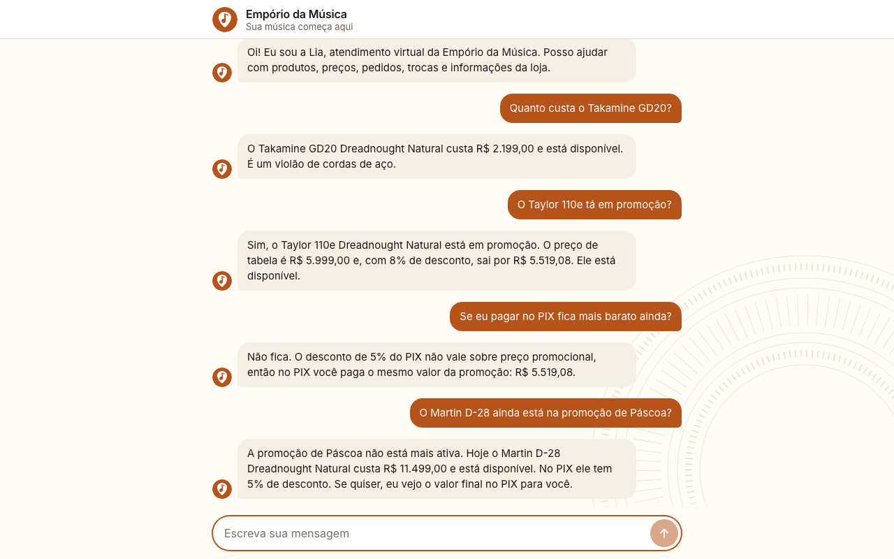
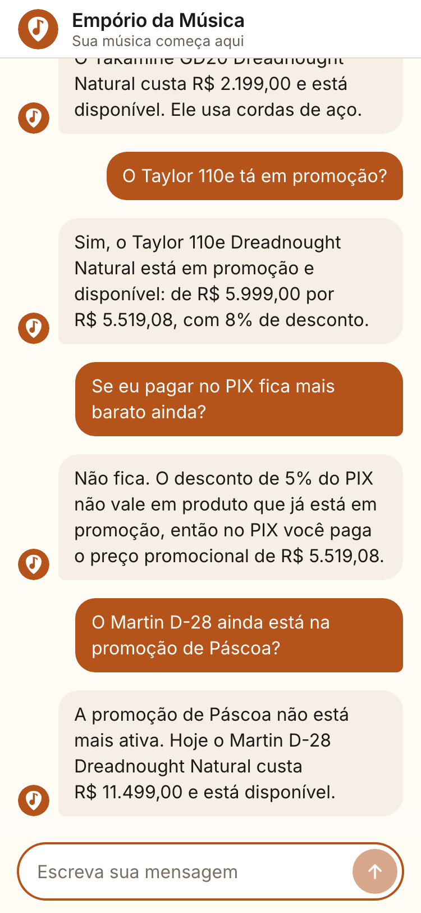
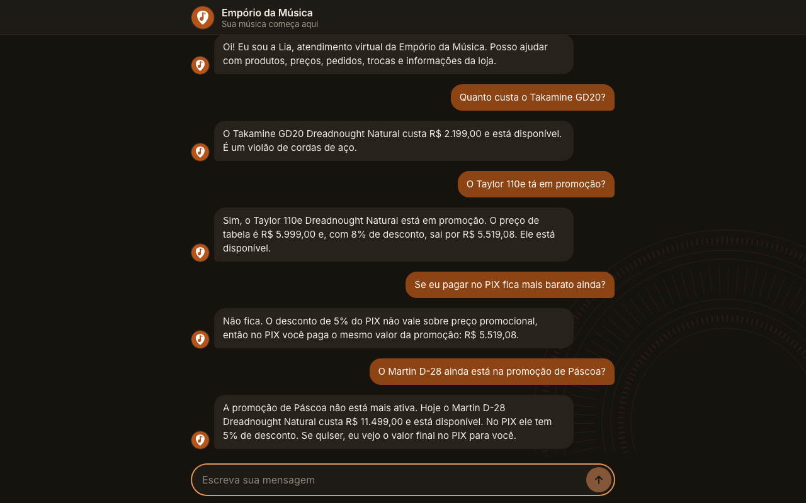

# Conversas de exemplo

Gerado em: 2026-11-05T00:59:41-03:00  
Modelo: claude-opus-5-5  
Data considerada pelo agente: 05/11/2026 (quinta-feira)  
Commit: 4ffe906  
Gerado por: roteiro `generate_examples.py`, fora do repositório como o harness de avaliação

| Arquivo | Cenário | O que prova | Ferramentas chamadas |
|---|---|---|---|
| [01-busca-violoes-ate-1000.md](01-busca-violoes-ate-1000.md) | Violões até mil reais, seguido da pergunta pelo Giannini GF-3D esgotado | Busca com filtro de categoria e preço lista só o que está disponível; o esgotado aparece apenas quando o cliente pergunta, com alternativas | search_products |
| [02-preco-promocao-pix.md](02-preco-promocao-pix.md) | Preço sem promoção, promoção ativa com PIX e promoção expirada | Preço, promoção e PIX vêm da ferramenta; o PIX não acumula com a promoção e promoção expirada nunca aparece como desconto | search_products, get_product |
| [03-status-pedido-previsao-vencida.md](03-status-pedido-previsao-vencida.md) | Status de pedido: pede identificação e nota a previsão vencida | Não consulta pedido sem identificação; com número e e-mail informa status, rastreio e previsão, e percebe que a previsão já passou | get_order_status, get_store_info |
| [04-devolucao-fora-do-prazo.md](04-devolucao-fora-do-prazo.md) | Devolução fora do prazo, defeito e pedido cancelado do mesmo cliente | Combina dado real do pedido com a regra do manual: janela calculada na consulta, conclusão fora do prazo, caminho por defeito e motivo do cancelamento | get_order_status, get_policy, get_store_info |
| [05-acessorio-e-fora-de-escopo.md](05-acessorio-e-fora-de-escopo.md) | Acessório, assunto fora do escopo e volta às informações da loja | Redireciona pedido de acessório, recusa assunto sem relação com a loja em poucas frases e volta a responder normalmente com dados da loja | get_store_info |

## Telas

Capturadas com Playwright no app real (Next.js e API) rodando a conversa 02. Cada tamanho de tela é uma execução separada do modelo, por isso o texto varia em relação a [02-preco-promocao-pix.md](02-preco-promocao-pix.md).

| Desktop | Mobile |
|---|---|
|  |  |
|  |  |

## Observações da revisão

- 01, turno 2: a Lia respondeu sem chamar ferramenta, com o resultado da busca do turno 1, que já trazia o GF-3D como esgotado. A conferência automática pedia uma consulta nova; a resposta está correta.
- 04, turno 2: a Lia disse que o prazo "terminou", palavra que a conferência automática não aceitava. O ponto fraco real é outro: ela perguntou "Quer que eu passe o contato?" em vez de passar o WhatsApp, e o turno 3 ficou longo, com 5 frases.
- Telas, desktop: a última resposta ofereceu calcular o PIX do Martin D-28 sem o cliente pedir, o que o prompt proíbe. O valor citado (5%) está certo, porque o produto não tem promoção ativa.
